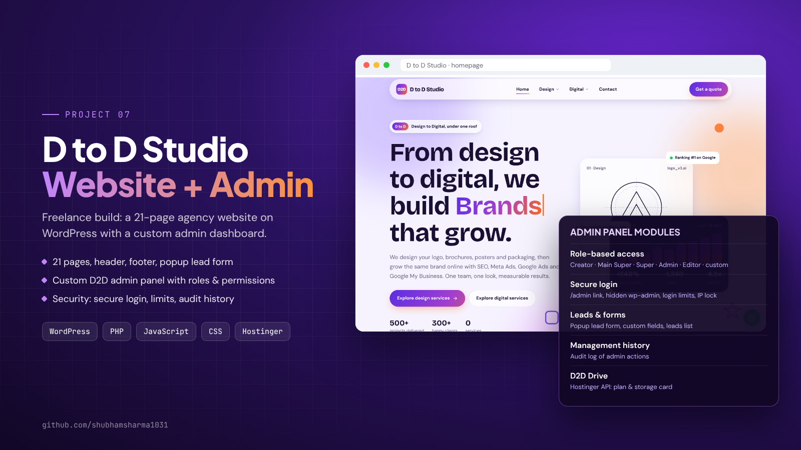
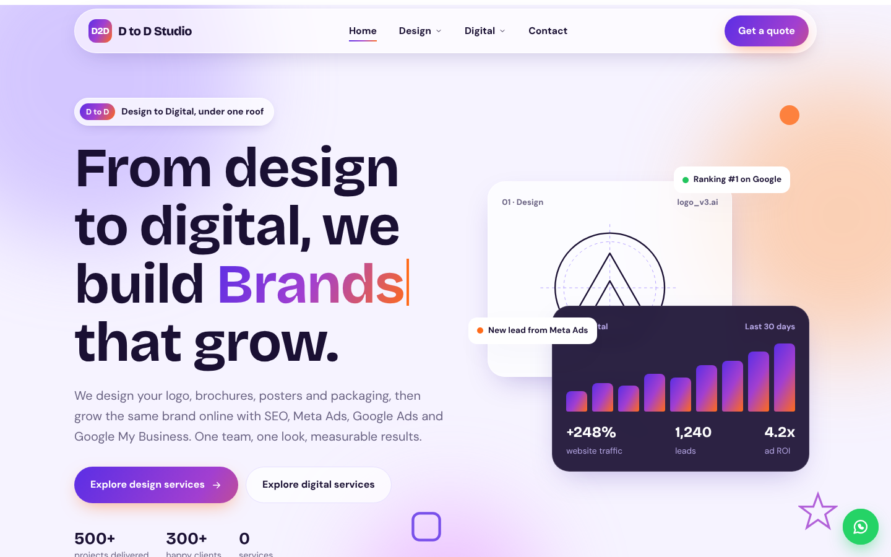
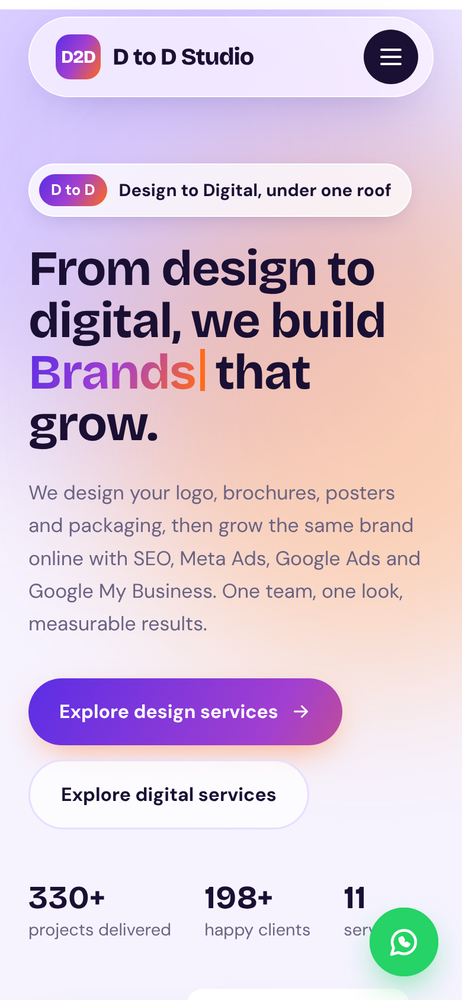
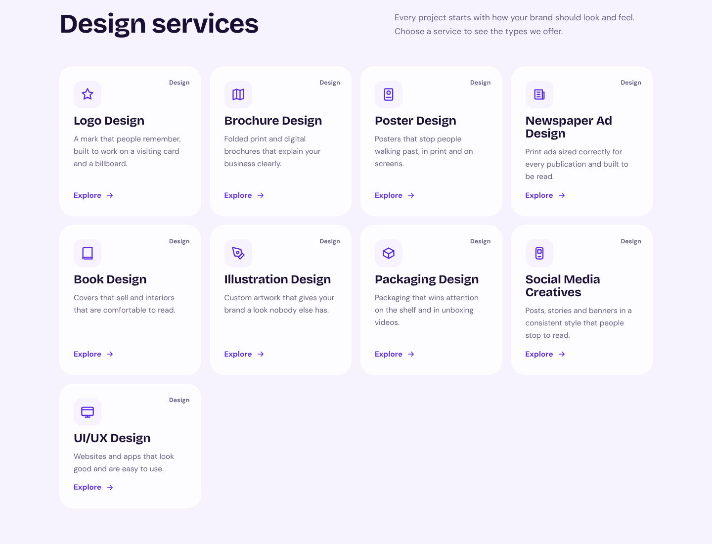
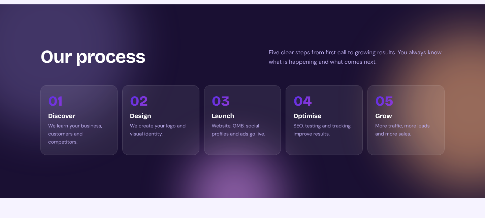

# D to D Studio – Agency Website + Custom Admin Panel

**Freelance client project · Oct – Nov 2026 · Live:** [mywindoows.online](https://mywindoows.online/)

D to D Studio ("Design to Digital") is a design and digital-marketing agency: logo, brochure, poster and packaging design on one side, and SEO, Meta Ads, Google Ads and Google My Business on the other. I built their website on WordPress, together with a custom admin dashboard that their team uses to run the site.

> This is a **showcase repository**. The source code belongs to the client and is not published here, and the security parts of the admin panel are deliberately kept private. This page explains what was built and how it works.

## What I built

### 1. The website (21 pages)
- Includes Home, Contact, a Design hub with 9 service pages (logo, brochure, poster, newspaper ad, book, illustration, packaging, social media, UI/UX) and a Digital hub with 7 service pages (SEO, Meta Ads, Google Ads, Google My Business, AEO, GEO, social media marketing)
- Shared header with dropdown menus, footer and a mobile menu
- Popup "Get a quote" lead form and a WhatsApp button on every page
- Animated hero with a typing headline, counters and scroll-reveal sections
- Sections for "How design connects to digital", a 5-step process, reasons to choose the agency and client reviews
- Fully responsive, from mobile to wide desktop

### 2. The custom admin panel
A dashboard of its own on top of WordPress, so the agency team does not have to use the default wp-admin screens.

| Area | What it does |
|---|---|
| **Roles & permissions** | Creator, Main Super Administrator, Super Administrator, Administrator and Editor, plus custom roles with line-by-line permissions. Sections can be locked per role. |
| **Team management** | Add, edit, block and delete users, per-user login limits, and a safe "open account" switch for support |
| **Secure login** | Own login page instead of wp-login, option to hide wp-admin, limited login attempts with a temporary IP lock, and an extra access check for sensitive areas |
| **Leads & forms** | Edit the fields of the quote form and see every lead that comes in |
| **Management history** | Audit log of admin actions (who changed what, and when) |
| **Site settings** | Contact details, office locations, theme options and site-wide and per-user time zones |
| **Hosting card** | Shows the hosting plan and storage information through the Hostinger API |

## Screenshots

| Desktop | Mobile |
|---|---|
|  |  |

**Design services grid**

**Process section**

## Tech stack
WordPress · PHP (custom theme) · JavaScript · CSS · Hostinger

## My role
I handled the full build as a freelancer: page structure and content layout, the front-end design and animations, the custom theme, the admin panel and its access rules, and the launch on Hostinger.

---
Shubham Sharma · [Portfolio](https://shubhamsharma1031.netlify.app/) · [LinkedIn](https://www.linkedin.com/in/shubhamsharma1031)
