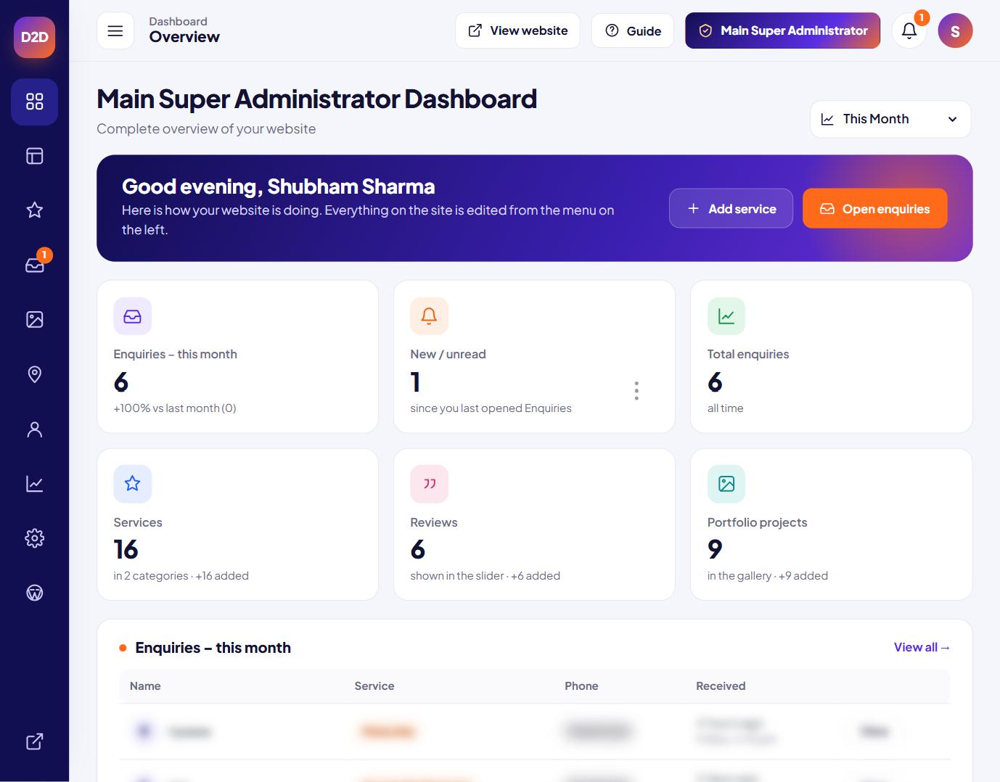
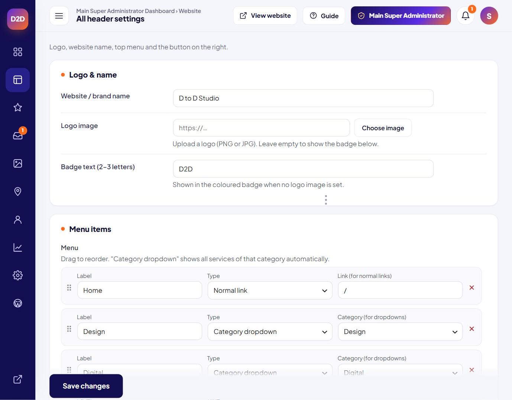
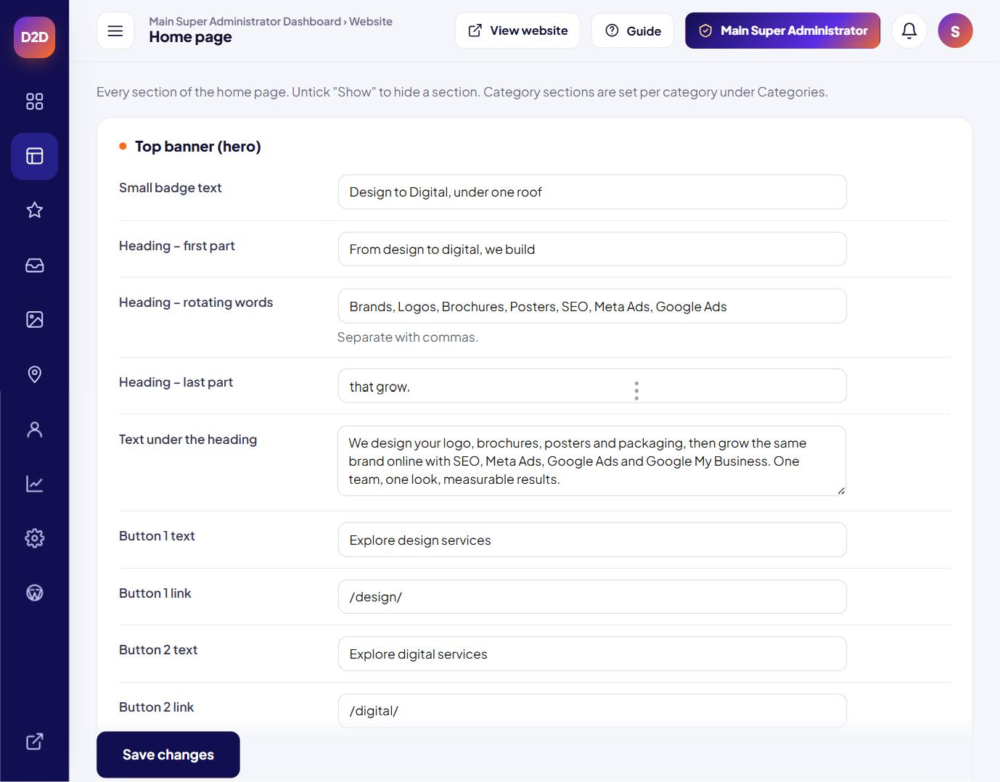
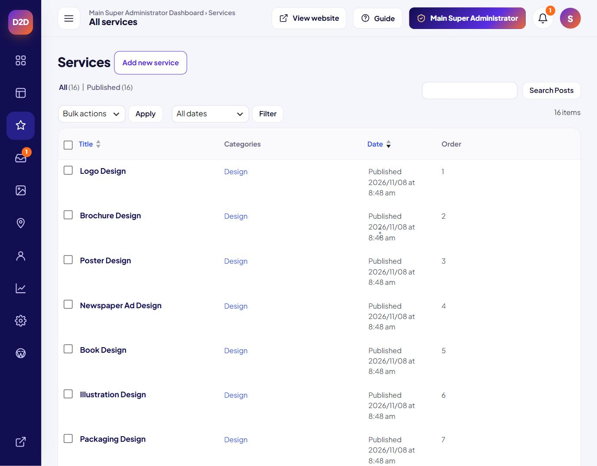
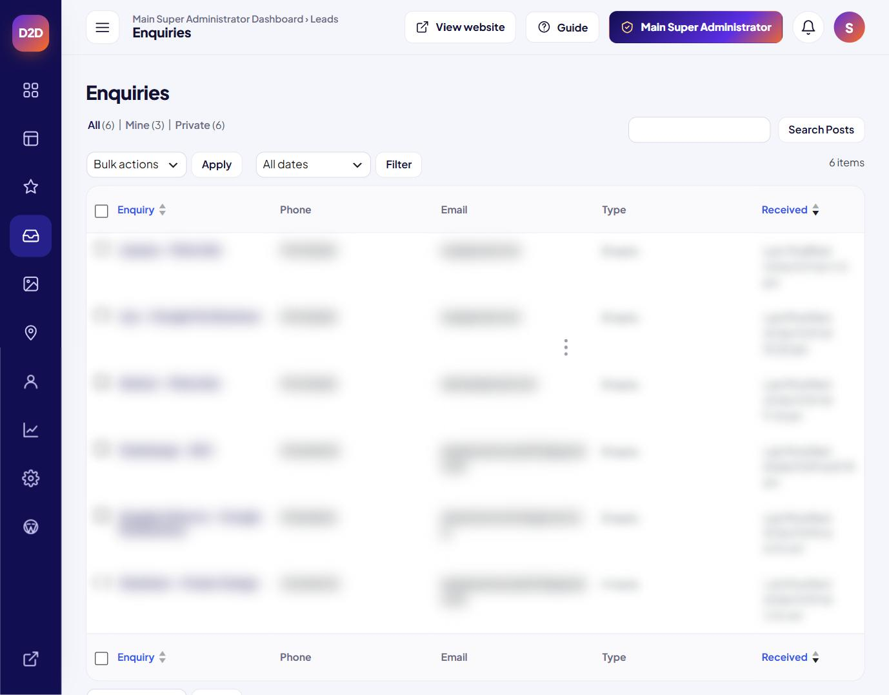
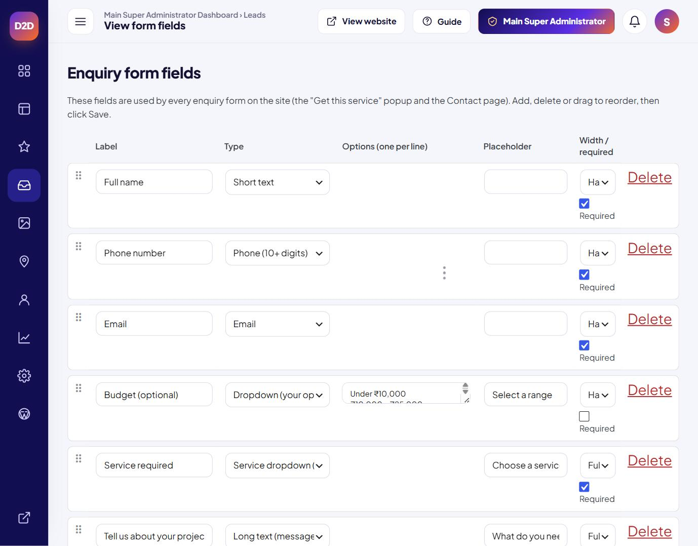
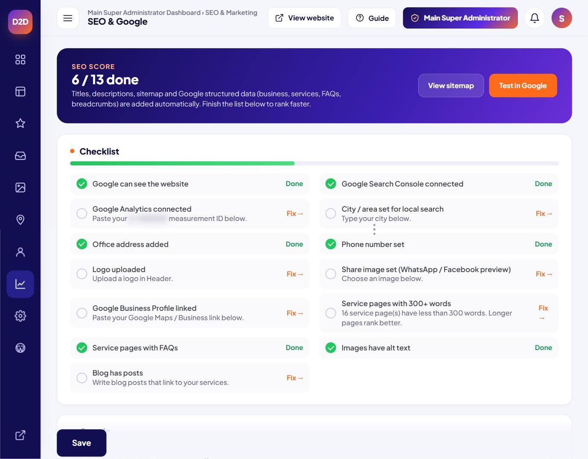
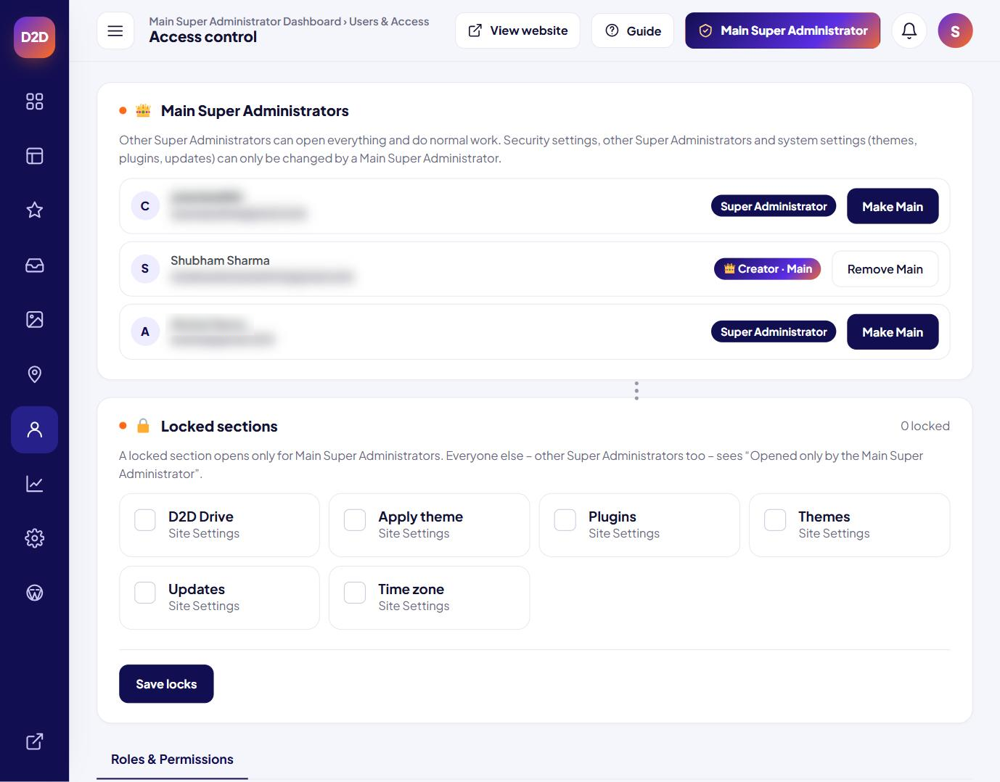
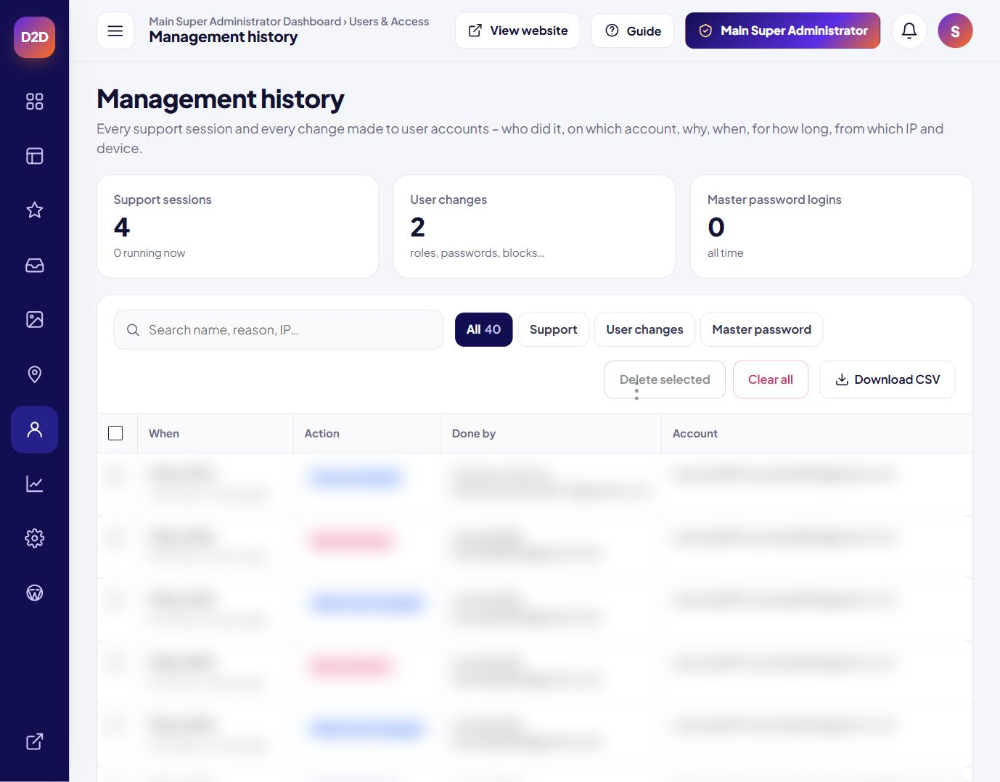
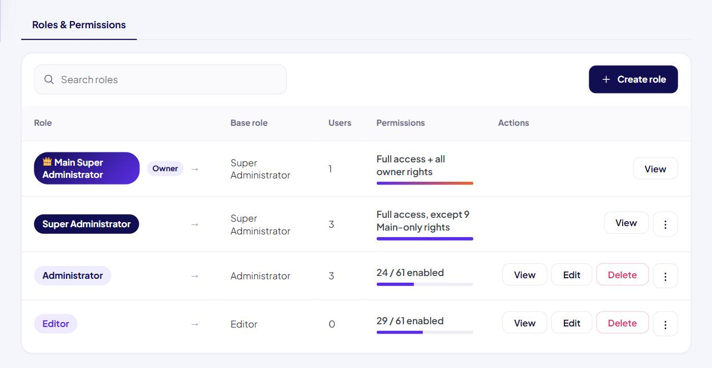

# D to D Studio – Agency Website + Custom Admin Panel

**Freelance client project · Oct – Nov 2026 · Live:** [mywindoows.online](https://mywindoows.online/)

D to D Studio ("Design to Digital") is a design and digital-marketing agency: logo, brochure, poster and packaging design on one side, and SEO, Meta Ads, Google Ads and Google My Business on the other. I built their website on WordPress, together with a custom admin dashboard that their team uses to run the site.

> This is a **showcase repository**. The source code belongs to the client and is not published here, and the security parts of the admin panel are deliberately kept private. This page explains what was built and how it works.

## What I built

### 1. The website (21 pages)
- Includes Home, Contact, a Design hub with 9 service pages (logo, brochure, poster, newspaper ad, book, illustration, packaging, social media, UI/UX) and a Digital hub with 7 service pages (SEO, Meta Ads, Google Ads, Google My Business, AEO, GEO, social media marketing)
- Shared header with dropdown menus, footer and a mobile menu
- Popup "Get a quote" lead form and a WhatsApp button on every page
- Animated hero with a typing headline, counters and scroll-reveal sections
- Sections for "How design connects to digital", a 5-step process, reasons to choose the agency and client reviews
- Fully responsive, from mobile to wide desktop

### 2. The custom admin panel
A dashboard of its own on top of WordPress, so the agency team can run the whole site without touching the default wp-admin screens. Every part of the website is edited from this panel.

| Area | What it does |
|---|---|
| **Dashboard** | Greeting, quick actions and live counts: enquiries this month (with change vs last month), unread enquiries, services, reviews and portfolio projects, plus the latest enquiries |
| **Website editors** | Separate editors for the header (logo, menu with drag-to-reorder and category dropdowns, right-side button), footer, every home page section and brand colours |
| **Content** | Services with categories, client reviews for the slider, portfolio projects with categories, office locations and contact details |
| **Enquiries & forms** | Every quote request in one list (All / Mine / Private), a form builder for the quote form (field type, options, placeholder, width, required) and export to Google Sheets |
| **SEO & Google** | SEO score with a 13-point checklist, automatic titles, descriptions, sitemap and structured data, plus Google Search Console, Analytics and Business Profile settings |
| **Roles & permissions** | Creator, Main Super Administrator, Super Administrator, Administrator and Editor, plus custom roles built from 61 individual permissions. Sections can be locked so only a Main Super Administrator can open them |
| **Team** | Add, edit, block and delete users, per-user login limits and a safe "open account" switch for support |
| **Secure login** | Its own login page, option to hide wp-admin, limited login attempts with a temporary lock, and an extra access check before the most sensitive areas |
| **Management history** | Audit log of support sessions and user changes: who did it, on which account, why, when and for how long, with filters and CSV export |
| **Site settings** | Site-wide and per-user time zones, help guides for every role, and a hosting card that shows the plan and storage through the Hostinger API |

#### Admin panel screenshots
Customer details, user names, emails and log entries are blurred. Security settings are not shown.

**Dashboard**

| Header editor | Home page editor |
|---|---|
|  |  |

| Services | Enquiries (blurred) |
|---|---|
|  |  |

| Quote form builder | SEO & Google |
|---|---|
|  |  |

| Access control & locked sections | Management history (blurred) |
|---|---|
|  |  |

**Roles & permissions**

## Website screenshots

| Desktop | Mobile |
|---|---|
|  |  |

**Design services grid**

**Process section**

## Tech stack
WordPress · PHP (custom theme) · JavaScript · CSS · Hostinger

## My role
I handled the full build as a freelancer: page structure and content layout, the front-end design and animations, the custom theme, the admin panel and its access rules, and the launch on Hostinger.

---
Shubham Sharma · [Portfolio](https://shubhamsharma1031.netlify.app/) · [LinkedIn](https://www.linkedin.com/in/shubhamsharma1031)
